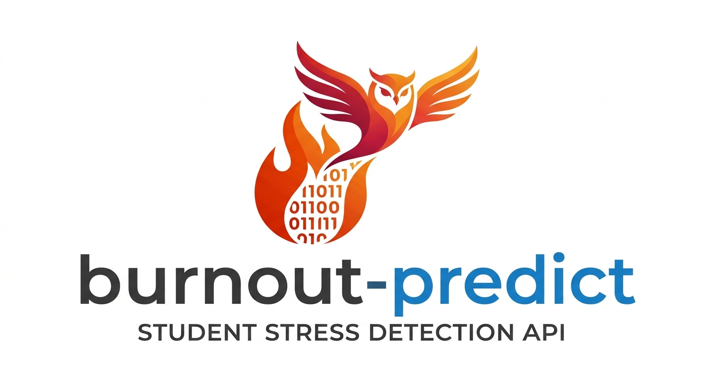

  <h1><b>🦉 burnout-predict</b></h1>

  

## The Problem

Academic institutions increasingly face high rates of student burnout, driven by heavy course loads, sleep deprivation, excessive screen time, and psychological stress. While early intervention can prevent severe academic failure and psychological distress, educational institutions lack automated tools to flag students at high risk before they reach a breaking point.

Traditional assessments rely on manual, post-hoc evaluations that fail to identify elevated stress levels in real time. Survey-based telemetry (capturing academic demands, lifestyle habits, and socio-economic support) contains strong predictive signals, but without automated scoring, these metrics sit idle in raw datasets.

### The Machine Learning Solution

`burnout-predict` addresses this by providing a deployable an end-to-end classification pipeline.

This API is designed to be integrated into:

* **Academic Advising Dashboards:** Automatically triaging students who may need academic extensions or counseling resources based on self-reported periodic surveys.
* **Personal Wellbeing Applications:** Powering client-facing tools that alert users when their current work-to-rest ratio crosses a dangerous threshold.
